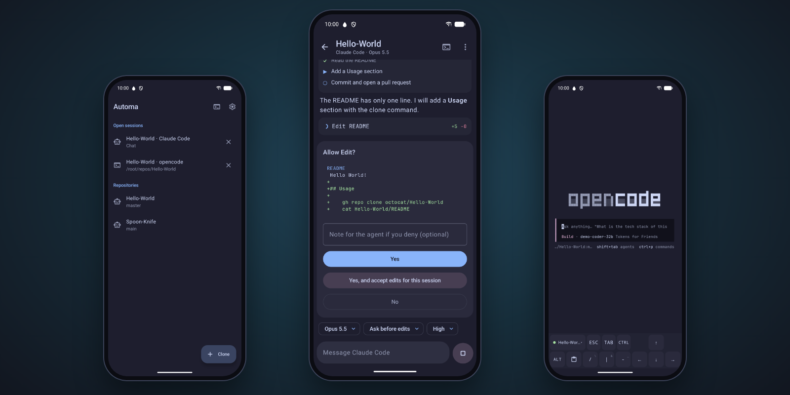

<div align="center">


# Automa

**AI coding agents, running on your phone.**<br>
opencode, Claude Code and Codex in a small Linux environment with git and the GitHub CLI. All of it
runs locally on Android. No Termux, no remote computer, no trackers.

[](#build)
[](#security)
[](LICENSE)



</div>

## About

Automa runs [opencode](https://github.com/anomalyco/opencode), the AI coding agent, on the phone
itself. It is not a remote control for a computer. The app has a small Alpine Linux system that runs
with PRoot, and a terminal for the opencode TUI and a shell. Log in to GitHub, clone repositories,
let opencode do fixes and analysis, then commit, push and make releases from the phone.

Each agent has two UIs: a chat made for touch, and its own terminal UI. In the chat, each permission
request, each question with options and each plan of the agent is a card with buttons.

opencode gets its AI models from Tokens for Friends (TFF), an OpenAI-compatible gateway, and shows
only the TFF models. Claude Code and Codex are optional: install them in Settings and log in with
your own Claude or ChatGPT account. The models run at the provider; all other parts run locally.

## Features

- **Chat**: tap a repository, then an agent. The chat shows the answers as formatted text, each
  command and file change as a card (tap it for the output and the diff), and the task list. Each
  request of the agent is a card: Yes, "do not ask again" rules, No with a note for the agent;
  questions with one or more options and an own answer; plan approval. Chips change the model, the
  mode (for example Plan) and the effort. Stop ends the turn. The terminal button opens the same
  session in the terminal UI of the agent.
- **The real opencode**: the official opencode build for Linux arm64, in the chat or in its own
  terminal. When opencode stops in the terminal, a shell stays open in the same folder.
- **Claude Code and Codex**: Settings → Coding agents installs them on demand (each one is a
  download of about 100 MB, and about 290 MB on the phone). Then the repository sheet opens
  them. Log in with your account at the first start: Automa shows the login link and opens the
  browser after a tap. Select the model with `/model`. Remove deletes the program; your login
  stays.
- **Tokens for Friends**: add `TFF_API_KEY` in API keys. Automa gets the TFF model list and gives
  it to opencode. The opencode model list shows only the TFF models. Tap reload on the API keys
  screen to get a new list.
- **Polished look**: the look of Varco. Catppuccin Mocha colours in the app, the terminal and
  opencode, the JetBrains Mono font, and a full-screen terminal.
- **GitHub login**: the device flow of the official GitHub CLI. Automa shows a code; you type it
  on github.com. git and gh then work with no more questions: clone private repositories, push,
  `gh pr create`, `gh release create`.
- **Clone**: `owner/repo`, an https link, or one or more repositories from your account list.
- **Terminal**: two rows of extra keys for Esc, Tab, Ctrl, Alt, paste and the arrows (they repeat
  while held). Tap Ctrl or Alt for one key, or hold to lock it. The session chip opens Home, Share,
  Close and the other sessions. Pinch to change the text size.
- **Share results**: share the selected text or the whole session with the share sheet. The home
  folder is in the system Files app, so you can open, share and import files.
- **Runs in the background**: opencode continues with the screen off. A notification shows the
  open sessions and stops them. The setup, an update, a clone and the GitHub login also continue
  when you go to another app (for example to the browser for the login).
- **API keys**: keep provider keys (for example `TFF_API_KEY`) encrypted in the app. Each new
  session gets them as environment variables.
- **Update**: Settings → Update installs the newest opencode 2.x release, the newest Claude Code and
  Codex (when installed) and the newest Alpine packages (git, gh and the other tools). It runs only
  when you tap it.
- **App lock**: fingerprint, face or screen lock.

## Security

- The setup downloads have pinned SHA-256 digests: the Alpine minirootfs 3.24.4 and opencode 2.3.1.
  Alpine packages are signed by Alpine; the minirootfs has the keys.
- Update: opencode comes from the newest stable GitHub release of the 2.x line, checked with the
  SHA-256 that GitHub gives for the file. Automa does not install an older version or a pre-release.
- opencode 2.x has no shared background server in Automa (`~/.config/opencode/service.json`): each
  start has its own server, which ends with the session.
- Claude Code and Codex: the install has pinned SHA-256 digests (Claude Code 2.1.311, Codex
  0.169.0). An update takes the newest stable release with the SHA-256 of the publisher (the Claude
  Code manifest, the GitHub digest for Codex).
- Links from programs (the agent logins): Automa shows the host and opens the browser only after a
  tap. Only https links.
- Codex runs with `sandbox_mode = "danger-full-access"`, because its Linux sandbox cannot run under
  PRoot. The Android app sandbox is the limit, the same as for opencode and Claude Code. In the chat,
  the mode "Ask before changes" makes Codex ask before each command and each file change.
- Chat and trust: a cloned repository cannot start programs (hooks, MCP servers, project settings)
  before you trust it. Claude Code uses the trust that you gave in its terminal UI; until then the
  chat loads no project settings. Codex asks in the chat before its first start in a folder.
- The opencode chat (`opencode acp`) has a server on 127.0.0.1 inside. Automa gives it a new random
  password at each start, so other apps on the phone cannot use it. The chat itself opens no port.
- The GitHub token and the API keys are encrypted with an AES-256-GCM key in the Android Keystore
  (StrongBox when available). The APK has no OAuth client ID and no API key.
- git uses the GitHub CLI as its credential helper, so the token is never in `.git/config` or in a
  link. Commits use your GitHub no-reply address, not your private e-mail address.
- The secrets go to the guest in the process environment, not on the command line.
- The TFF model list: the request with your key has no redirects, so the key goes to no other host.
  Automa accepts only model names with plain characters (no terminal control sequences).
- A cloned repository cannot start code when opencode opens: opencode does not load the project
  `opencode.json` and `.opencode/` (plugins, MCP commands). To use them in your own projects, put
  `unset OPENCODE_DISABLE_PROJECT_CONFIG` in `~/.profile`.
- A stop or a close ends each process of the session, not only PRoot.
- No recents preview. "Stop all" needs an unlocked phone. Only the session on the screen can set
  the clipboard.
- The tar reader refuses absolute paths, `..` and writes through a symbolic link. The documents
  provider never leaves the home folder (no `..`, no links out of a granted folder), and it refuses
  all access while the app lock is on.
- No backup of app data, hardened memory (`memtagMode="sync"`), HTTPS only with the system CAs.
- On GrapheneOS, set "Native code debugging" to Allowed for Automa (App info): PRoot uses `ptrace`.
  If it is blocked, the setup tells you and opens App info. Also, do not turn on "Restrict dynamic
  code loading" for Automa: PRoot loads the Linux programs from app storage, and opencode uses a JIT
  compiler.

Limits:

- The programs in a session can read the secrets in their environment, the same as on a computer.
  Keys that you add with `/connect` in opencode go into a plain file in app storage
  (`~/.local/share/opencode`). Use the API keys screen of Automa for encrypted keys. The logins of
  Claude Code and Codex are also plain files (`~/.claude`, `~/.codex`).
- The guest sends DNS queries without encryption. Automa gives it the same DNS servers as Android:
  the Private DNS server in strict mode, else the servers of the network or the VPN
  ([research F-5](docs/research/feasibility.md)).
- Logout deletes the token on the phone. The token stays valid on GitHub until you revoke it
  (Settings → Applications → GitHub CLI).

## Privacy

No analytics, no crash reporter, no Google Play Services, no ads.

opencode starts with these defaults (you can change them in `~/.config/opencode/opencode.json` and
`~/.profile`):

- no share links (`"share": "disabled"`), no update check, no free OpenCode Zen models;
- no model list from models.dev (opencode uses its built-in list);
- Claude Code: `CLAUDE_CODE_DISABLE_NONESSENTIAL_TRAFFIC=1` (no telemetry, error reports or
  self-update). Codex (`~/.codex/config.toml`): no analytics, no feedback upload, no update check;
- only the TFF provider (`"enabled_providers": ["tff"]`). Automa writes the TFF provider and its
  models to the managed config `/etc/opencode/opencode.json`. To use other providers, remove
  `enabled_providers` from `~/.config/opencode/opencode.json`;
- the OpenCode Zen provider is off (`"disabled_providers": ["opencode"]`). Its free model would
  send your first prompt to opencode.ai before you select a provider.

The app connects to:

| Host | When |
|---|---|
| `dl-cdn.alpinelinux.org` | Setup and `apk` in a shell |
| `github.com`, `release-assets.githubusercontent.com` | opencode download at setup and update |
| `api.github.com` | Update: the newest opencode version (only when you tap Update) |
| `github.com`, `api.github.com` | git and gh: login, clone, push, releases |
| `downloads.claude.ai` | Claude Code install and update (only when you tap them) |
| `github.com`, `api.github.com` | Codex install and update (only when you tap them) |
| `claude.com`, `platform.claude.com`, `api.anthropic.com` | Claude Code: login and each prompt |
| `auth.openai.com`, `chatgpt.com` | Codex: login and each prompt |
| `gateway.trytokenfactory.dev` | The TFF model list (when you save `TFF_API_KEY`, tap reload, or the setup runs), and each prompt in opencode |

## Download

There is no release yet. Build the app from source (see [Build](#build)).

## Build

Requirements: JDK 21, the Android SDK (platform 37), and the NDK that AGP selects.

```sh
./scripts/fetch-proot.zsh   # only to update PRoot; the checked files are in app/src/main/jniLibs
JAVA_HOME=/opt/homebrew/opt/openjdk@21 ./gradlew :app:testDebugUnitTest :app:lintDebug :app:assembleDebug
JAVA_HOME=/opt/homebrew/opt/openjdk@21 ./gradlew :app:assembleRelease
```

The release APK is about 3.0 MB (estimate). After the setup, the environment uses about
330 MB of app storage (estimate: opencode 248 MB, packages 75 MB).

<details>
<summary><b>How Automa runs Linux programs</b></summary>

From targetSdk 29, Android does not let an app start a program from its data folder. The native
library folder of the APK is executable, so PRoot and its loader are in the APK as `libproot.so`
and `libproot-loader.so`. PRoot runs the Alpine programs with `ptrace`; its loader maps them into
memory. Each session is `proot -0 -r rootfs … /bin/bash -l` on a pseudo-terminal of the Termux
terminal view. A foreground service holds the sessions and a partial wake lock.

Setup steps (each can run again; a failed setup continues): download and extract Alpine, write the
Automa files (`/etc/profile.d/automa.sh`, `/etc/gitconfig`, opencode config and theme, the TFF
model list), `apk upgrade` and `apk add`, download opencode. Details: [docs/DESIGN.md](docs/DESIGN.md).

</details>

<details>
<summary><b>Project layout</b></summary>

```
app/src/main/kotlin/app/automa/
  env/      Pins, Setup, Env (PRoot command), Agents (Claude Code, Codex), Tff (model list), Tar,
            Download, Dns, Tree
  term/     Sessions, SessionService, Look (colours and font), Links (xdg-open)
  chat/     Pipe (JSON lines), Rpc, Model, Claude, Codex and opencode drivers, Chats
  git/      GitHub (device flow with gh), Repos
  data/     Vault, Secrets, Prefs
  files/    HomeProvider (documents provider)
  ui/       home, setup, term, chat, keys, settings, nav, theme
app/src/main/jniLibs/arm64-v8a/   PRoot, loader, talloc, libandroid-shmem (scripts/fetch-proot.zsh)
terminal/                         Termux terminal-emulator and terminal-view (Apache-2.0)
docs/                             DESIGN.md, research/, review/, LIVE-TESTS.md
```

</details>

<details>
<summary><b>Validation</b></summary>

- Unit tests: tar reader (unsafe names, links, pax and GNU names), clone sources, gh output, setup
  plan, version order, release data, secret names, resolv.conf, /proc parent PIDs, TFF model list,
  the three chat protocols (scripted messages), the Markdown reader and the line splitter.
- An independent privacy and security review: [docs/review/privacy-security.md](docs/review/privacy-security.md).
- Emulator (AOSP API 35, arm64, 4 KB pages), debug and release (R8) builds: setup, clone of a
  public repository, the opencode TUI (keys, Ctrl+P, Esc), a shell, the session notification and
  the Files app root.
- Emulator (Android 17, API 37, 16 KB pages): setup, setup update, the opencode TUI, and that a
  login cancel, a session close and "Stop all" leave no guest process.
- Emulator (Android 17, API 37), version 0.3.0: the opencode model list with a made-up TFF config
  shows only TFF models, the `catppuccin` theme, the extra keys and the session sheet, and a made-up
  key gives "Server answered HTTP 401".
- Emulator (Android 17, API 37), version 0.4.0: install, Remove and install again of Claude Code
  and Codex, their first-start screens, and the "Open the link" bar for both logins.
- Emulator (Android 17, API 37), version 0.5.0: the chat of each agent starts under PRoot with no
  login, the login cards, the Codex trust card, and the opencode loopback port refuses other apps
  (HTTP 401). Unit tests drive the three chat protocols with scripted messages.
- Emulator (Android 17, API 37), version 0.6.0: the update to opencode 2.3.1, its terminal UI and
  chat under PRoot, no shared background server, and Settings → Update on the 2.x line.
- Not tested yet: chat turns with a real agent (live test L-10), the TFF model list with a real key, the Claude Code and Codex logins and tasks,
  the clone of more than one repository (it needs a GitHub login), GitHub login, push (live tests for the owner,
  [docs/LIVE-TESTS.md](docs/LIVE-TESTS.md)), and the behaviour on a Pixel with GrapheneOS.

</details>

## License

Automa is free software under the [GNU General Public License v3.0](LICENSE). It includes PRoot
(GPL-2.0-or-later), talloc (LGPL-3.0-or-later), libandroid-shmem (BSD-3-Clause), all from the Termux
packages, the Termux terminal-emulator and terminal-view (Apache-2.0), and the JetBrains Mono font
(OFL-1.1, `docs/licences/`). The app uses AndroidX, Jetpack Compose and Kotlin coroutines
(Apache-2.0), and Material Symbols icons (Apache-2.0). Alpine Linux, opencode, git and the GitHub CLI
download at setup, Claude Code and Codex download when you install them; they have their own
licences.

---

<sub>Automa is an independent project. It is not affiliated with opencode, Anomaly, Anthropic,
OpenAI, Tokens for Friends, Termux, Alpine Linux or GitHub.</sub>
